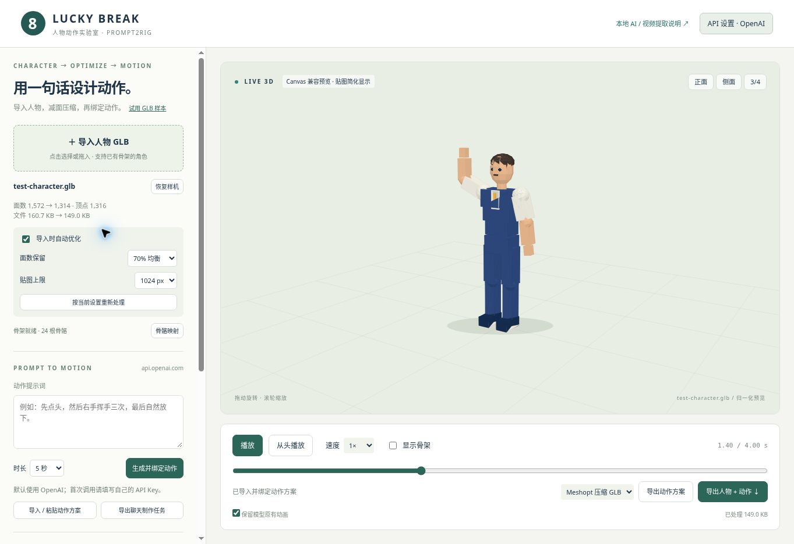

# Lucky Break · Prompt2Rig 人物动作测试工程

独立实验目录，未修改 `3D_AItool` 原应用。基于 [blendi-remade/prompt2rig](https://github.com/blendi-remade/prompt2rig)，固定研究版本为 `fe3d3eec992772b538992374ca933020ed517938`，研究日期 2026-10-29。

## 先看动作

**在线查看：[GitHub Pages 动作实验室](https://giogyan90.github.io/3D_AItool/lab/)**。支持导入 GLB、自动减面压缩、提示词制作动作、骨骼映射、动作方案导入和人物动画导出。API 设置默认 OpenAI，也支持自定义兼容接口。

新增流程：**导入人物 → 自动优化 → 输入提示词 / 导入聊天方案 → 绑定动作 → 导出 GLB**。详见 [可复用工作流](docs/WORKFLOW.md)。

本地运行：

```powershell
git clone https://github.com/GioGyan90/3D_AItool.git
cd 3D_AItool/experiments/prompt2rig
node server.mjs
```

浏览器打开 <http://localhost:5177/lab/>。Node.js 18+；查看、导入、优化与方案绑定无需 `npm install`、密钥或 GPU，在线提示词生成需要自己的 API Key。依赖随工程保留对应许可。请通过 HTTP 打开，不要双击 HTML。



| 测试动作 | 时长 | 帧数 | 导出 GLB |
| --- | ---: | ---: | --- |
| 挥手致意 | 4 秒 | 121 | [luckybreak_wave.glb](samples/luckybreak_wave.glb) |
| 胜利庆祝 | 5 秒 | 151 | [luckybreak_victory.glb](samples/luckybreak_victory.glb) |
| 俯身出杆 | 6 秒 | 181 | [luckybreak_billiards.glb](samples/luckybreak_billiards.glb) |

以上是原创低模骨骼样机与**程序编排的关键帧测试**，并非 fal / GVHMR 生成结果。使用上游的 `Rig → snapshot → Track → trackToClip`，验证骨骼动作、采样、播放和导出。人物有 24 根骨骼、真实 `SkinnedMesh`，部件采用刚性权重，适合验证流程，不作为成品人物美术。出杆为无球杆、无球桌的姿态样例，不是已校准的专业击球动作；手指尚未单独绑定。

可切换正面、侧面、3/4 视角，拖动旋转、缩放、暂停、逐时刻查看、调速、显示骨架；导出当前人物与动作 GLB，或统一动作方案 JSON。若浏览器缺少 WebGL，实验室自动用同一蒙皮和骨骼数据进行 Canvas CPU 预览，贴图作简化显示，导出保留真实贴图；原版视频提取页面仍依赖其 WebGL / MediaPipe 支持。

## 使用原版 AI / 视频动作提取

入口 <http://localhost:5177/index.html>，或实验室右上角链接。原版 UI 与核心提取逻辑保留。

1. **已有真人视频**：点击原版的 `load video…`，选择本地单人全身视频；浏览器 MediaPipe 路径不需要 fal。首次使用需联网下载 MediaPipe WASM、姿态模型和示例角色。这个实验环境没有完成该视频提取端到端验证。
2. **文字生成视频**：复制 `.env.example` 为 `.env`，在本机配置 `FAL_KEY`，重启 Node 服务；将实验室中对应的英文提示词粘贴到原版页面。密钥留在服务器，切勿提交。使用 fal 会按其服务规则计费。未配置时接口返回 503 和明确提示，不伪装生成成功。上游模型端点保留，尚未使用真实账号验证其可用性、价格或生成质量。
3. **自有角色**：原版支持 Mixamo 命名的 T-pose `.glb` / `.fbx`。普通未绑定模型、CharaBuilder 当前网格和二维立绘不会自动兼容，需要先绑定骨骼、检查名称、比例、朝向和蒙皮。
4. **HQ 提取（可选）**：Windows + NVIDIA GPU，准备 `uv`、`ffmpeg`，执行 `hq/setup.ps1`；自行注册获取 SMPL-X v1.1 模型，放到 `hq/body_models/smplx/SMPLX_NEUTRAL.npz`；运行 `hq/.venv/Scripts/python hq/worker.py`。手部 WiLoR 另需 MANO。完整说明见 [上游原文](UPSTREAM_README.md)。本次未安装或验证 HQ 链路。

本地视频导入目前走浏览器实时提取；上游 HQ 接口收取可访问的 `video_url`，没有替你实现“把浏览器 blob 文件自动上传给本地 HQ”。

## 接入 Three.js 游戏

GLB 已包含人物、骨骼、蒙皮和一个动画，加载后用 AnimationMixer 播放：

```js
// Meshopt 压缩导出需要配置解码器；通用 GLB 不需要此扩展。
import { MeshoptDecoder } from 'meshoptimizer';
const loader = new GLTFLoader().setMeshoptDecoder(MeshoptDecoder);
const gltf = await loader.loadAsync('/assets/luckybreak_victory.glb');
scene.add(gltf.scene);
const mixer = new THREE.AnimationMixer(gltf.scene);
mixer.clipAction(gltf.animations[0]).play();
// 在你的主循环中调用：mixer.update(deltaSeconds);
```

新的 motion-plan JSON 使用统一骨架空间，经过工具重定向到导入角色；其他游戏内要使用导出的实际 GLB 动画，或实现相同映射。球杆应单独建模、挂在手部插槽并校准握持，而非随头部变化；本实验尚未制作球杆或接入现有游戏。

## 检查与继续开发

```powershell
npm test
node --experimental-loader ./tests/vendor-loader.mjs tools/export-samples.mjs
```

第一条还检查减面保留 UV / 蒙皮 / morph、Meshopt 解码逐字节一致、导入导出后原有动画与新动作、A/T 姿态适配，以及模拟 API 响应和错误。第二条重生成 `samples/`。原版录屏工具 `tools/capture.mjs` 需要先 `npm ci`，不属于零依赖实验室启动路径。

主要文件：`public/lab/character.js` 是样机，`motions.js` 是初始动作，`motion-plan.js` 定义可复用动作协议，`assets.js` / `optimize.js` / `glb-codec.js` 负责导入、减面与压缩，`rig-adapter.js` 做骨架映射，`api.js` 调用提示词接口，`app.js` 是界面。`public/retarget.js` 保留上游实现。服务默认监听 `127.0.0.1`，仅开发预览参数 `--preview` 会监听全部接口。

研究结论、已验证项和下一步见 [RESEARCH.md](docs/RESEARCH.md)。

## GitHub Pages 发布

仓库 Pages 使用 `main` 分支的 `/docs` 目录。静态文件由以下命令生成并随代码提交：

```powershell
node experiments/prompt2rig/tools/build-pages.mjs
```

从仓库根目录执行该命令；调整实验室界面或动作后重新生成 `docs/`，一起提交。公开版在浏览器本地处理 GLB，通过用户设置的 API 制作动作方案；不托管 Node / fal / HQ 代理。

## 许可

保留上游 Apache-2.0 的 [LICENSE](LICENSE) 与 [NOTICE](NOTICE)，Three.js MIT 许可见 `public/vendor/THREE-LICENSE.txt`，Meshoptimizer MIT 许可见 `public/vendor/meshopt/LICENSE.md`，Draco Apache-2.0 许可见 `public/vendor/draco/LICENSE`。新增样机、动作与实验代码随本目录采用 Apache-2.0。

上游明确注明：GVHMR、SMPL-X、WiLoR、MANO 涉及研究 / 非商用限制，YOLO 涉及 AGPL 或商业授权。**上游代码开源并不意味着完整 HQ 链路可直接用于商业游戏。** 本次程序样例不调用这些模型；后续真实提取链路的使用与产物授权需要按相关组件条款进一步确认。
