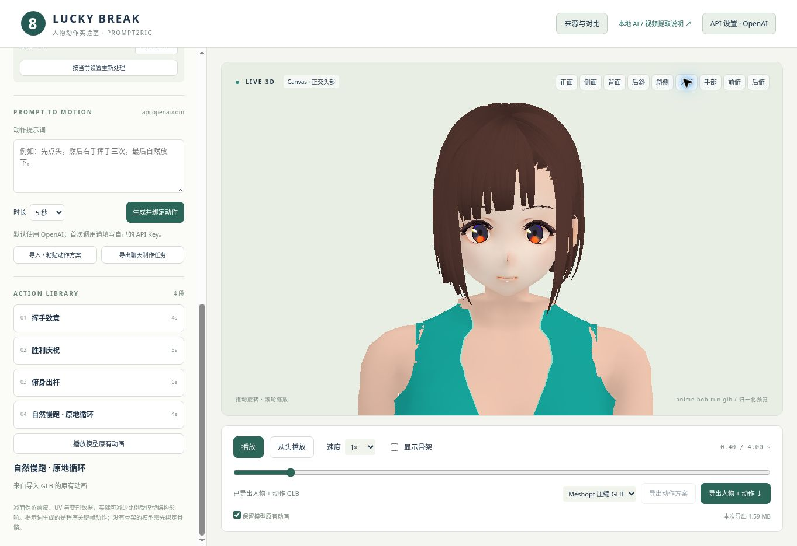
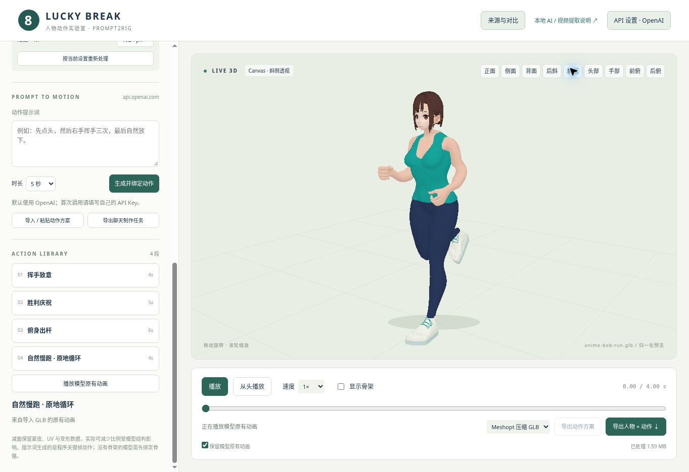

# 二次元女性：波波短发与运动装

制作日期：2026-10-31（北京时间）。用户要求“类似造型的二次元脸型的女人，波波头短发”。本角色作为独立选项接入，沿用青绿正常衣长背心、深蓝瑜伽长裤与浅色运动鞋；短发深栗色、齐下巴，为本轮制作选择。

网页方案为 `?model=bob`，优化前装配为 `?model=bob-source`。正常方案默认播放 4 秒原地跑，双手自然松握拳；“形体检查”返回绑定姿势。公开部署与实际网页复查状态单独记录在 [浏览器检查报告](ANIME_BOB_WOMAN_BROWSER_VALIDATION.json)。

## 形体与来源

成年身体使用原运动女性的独立 Quaternius 成年基础；服装、运动鞋、身体比例及 71 个实际关节全部保留。面部与后脑复用 pixiv VRoid Project beta `HairSample_Female` 的 CC0 头脸，波波发束与发底来自 beta `Sendagaya Shibu`，只取组件，不使用其身体与制服。没有宣称用户仓库已建立独立成女基础，也没有将原供体的年龄设定改称成年身体。

头脸是来源明确的现成几何，保留 UV 和彩绘五官，经过锚点拟合与绑定；本项目构建新的头颈连接并简化发束，整个人物不是从零雕刻。具体许可、固定提交、文件哈希与改造范围见 [SOURCES.md](../public/lab/characters/anime-bob-woman/SOURCES.md)。

新装配实际移除旧头脸和双束发。成年颈下段与二次元后脑 / 颈上段之间，用 94 面连接 62 / 32 顶点的真实边界圈，共享接缝位置、法线与权重；不靠遮挡隐藏悬空头部。脸部不受颈部加宽拟合影响。

| 项目 | 优化前装配 | 成品 |
| --- | ---: | ---: |
| 三角面 | 35,729 | 22,099 |
| 顶点 | 32,095 | 21,800 |
| 网格零件 | 26 | 26 |
| 实际骨骼节点 | 71 | 71 |
| GLB 字节 | 1,564,596 | 1,294,976 |

发束从 19,436 面简化至 5,812 面；实际达到的比例按边界约束记录，不把目标比例写成结果。26 个零件的统计见 [构建报告](ANIME_BOB_WOMAN_BUILD.json)。完整未遮挡成年基础仍在原运动女性目录；`source-reference.glb` 仅指本次穿衣装配的发束优化前版本。

## 动作、检查与修正

新角色沿用成年运动骨架的掌面、辅助骨及实际鞋底校正，在适配器中按独立预设登记。共 58 根动作骨骼，含 6 根膝 / 肘 / 前臂辅助骨；双手 30 根指骨保留并写入烘焙动画。默认跑步松握拳，切换挥手张掌；形体检查清除动作手型。

本轮新增 4 项角色检查，工程 **48 项全部通过**，包括身体 / 关节未变、真实接合边、独立载入状态、源装配对比、灰模切换及实际新角色整段跑步。权重比对允许小于 1e-8 的 GLTFLoader 归一化舍入，几何、UV、法线与骨索引逐值保持。

- 独立检查 242 个表面姿势（静止 + 实际跑步 60Hz），新增脸、后脑、颈与连接面同时参与，不复用旧角色的通过数字。
- 241 个烘焙采样、双手屈指与实际鞋底接触；46,464 个腰部样本最小间距约 1.62mm，未发现采样穿入。
- 新头颈两个边界圈在实际跑步多个相位逐点重合。表面最小法线对齐约 0.27570、最小面积比约 0.24108、最大边伸长约 2.29397。
- 烘焙 GLB 重载比较 218,000 个顶点，最大误差约 0.00000031m；保留 10 张嵌入贴图、30 条指骨轨道。详细范围见 [独立验证报告](ANIME_BOB_WOMAN_VALIDATION.json)。

实际浏览器完成本地成品材质、灰模正 / 侧 / 背 / 四分之三 / 前后俯视、头部近景、跑步 0 / 0.4s 及连续播放检查。第一轮灰模发现新眼线、高光等透明面片被旧命名匹配遗漏，去掉贴图后显示成块；现按网格与材质语义共同识别，灰模隐藏彩绘覆盖层，原材质和导出恢复全部面片，新增回归检查。未修改渲染器掩盖结构。





灰模检查使用同一成品的真实检查材质、静止姿势，通过现有网页 GLB 导入后备通道查看；该路径不冒充尚未部署的新预设界面。各视角原图及公开页验证状态见浏览器检查报告。

## 复现

先取得固定提交 `6ff7fa5c7b451c7318cf445038f1514a646343ea` 的 CharaBuilder 源仓库；成年运动女性装配须与本次来源哈希一致。在 `experiments/prompt2rig` 执行：

```sh
CHARABUILDER_SOURCE=/path/to/CharaBuilder node --experimental-loader ./tests/vendor-loader.mjs tools/build-anime-bob-woman.mjs
node --experimental-loader ./tests/vendor-loader.mjs tools/check-running-woman.mjs --bob --write
npm test
```

实际网页导出后执行 `node --experimental-loader ./tests/vendor-loader.mjs tools/check-browser-run-export.mjs /path/to/download.glb --bob`；通过旧页面导入文件后播放原生动画再导出时额外加 `--imported`，该模式包含标准导入的 1.8m 归一化。

交付文件位于 `public/lab/characters/anime-bob-woman/`：`assembled-anime-bob-woman.glb` 为静止人物，`anime-bob-woman-run.glb` 为完整人物与跑步，`running-plan.json` 为动作数据，`source-reference.glb` 为发束减面前对比。保留构建器、逐件清单、来源哈希和所有检查报告。从仓库根执行 `node experiments/prompt2rig/tools/build-pages.mjs`，与根 `docs/` 页面一起提交发布。

当前头脸为中性表情并随 Head 刚性绑定，没有眨眼 / 口型与头发动力学。材质采用源贴图与便携 basic / 粗糙度表现，尚未实现完整 MToon。实际复查使用 Canvas CPU 兼容预览，未验证 GPU WebGL；原地跑仍为实际鞋底垂直接触校正，不是完整足部 IK 或无滑步保证。
