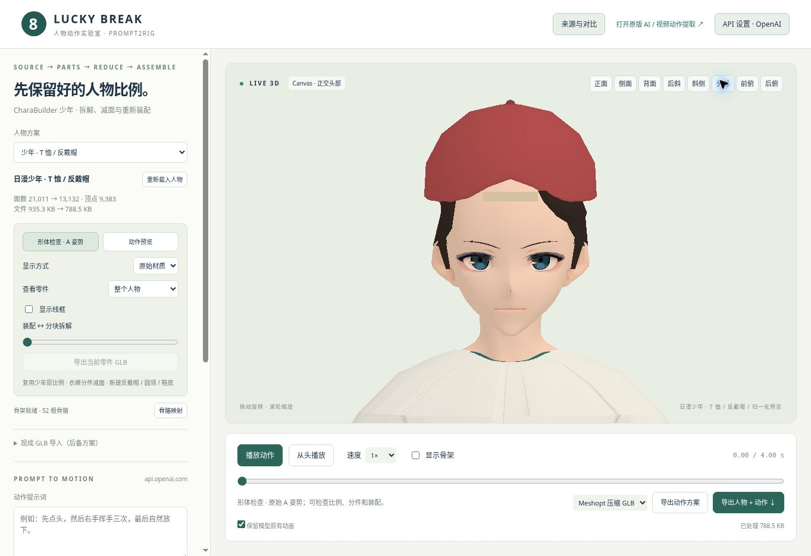

# CharaBuilder 少年：复用、拆解、减面与重新装配

默认人物来自用户自己的 [CharaBuilder](https://github.com/GioGyan90/CharaBuilder/tree/6ff7fa5c7b451c7318cf445038f1514a646343ea) 少年预设。头身比例、脸部、骨骼及四肢长度以原预设为基准，仅统一缩放。之前的独立截面灰模保留作对比，不再作为这个人物的身体。

## 拆解和减面

先将共享大缓冲按可见索引紧凑化，再按材质简化。眉毛、虹膜、眼白、高光、眼线等细小组件保留面数；面部皮肤保留较高比例，衣裤承担主要减面。保留 UV、材质和原骨骼索引 / 权重。简化完成后再沿关节与服装语义分件，避免分别简化新接缝使两边错开。

最终装配体有 35 个网格零件：五官 / 皮肤 / 耳部、原短发三分区、颈部与后脑、双臂 / 双手 / 脚踝、衣身 / 短袖 / 肩部补片 / 圆领、裤腰胯 / 裤腿、鞋面 / 鞋底、反戴帽四件。保留 91 个实际骨骼节点，其中 52 个被标准动作驱动器识别。

- 原人物 21,011 三角面；补件后 13,132 三角面，减少约 37.5%。
- 源几何紧凑化并拆件后 13,855 顶点；最终装配约 9,383 顶点。原运行时共享缓冲含额外未引用顶点，不能把它们当作美术细节减少量。
- 同样嵌入贴图、同样压缩的对比 GLB 约 935 KB；装配体约 789 KB。实际大小见 [逐件报告](CHARABUILDER_BOY_VALIDATION.json)。

反戴帽的帽檐全部位于脸部反方向。帽内发梢裁切，额前调节带独立；鞋底根据原鞋的范围拟合。原立领和六个生成纽扣移除，肩片从实际衣物切边重建，并用原肩颈皮肤采样校正间距；圆领顺着基础体的实际截面布置。没有将开口或穿插藏在双面材质里。

## 对比与导出

网页“人物方案”可以切换装配少年、原始少年和上一版灰模。三者使用相同相机，正 / 侧 / 背 / 斜侧、头部、前俯和后俯均可检查。显示原始材质、灰模、分部颜色、线框，或选择单件及分块拆解。

查看状态不会写进装配导出：导出临时还原所有零件、原始材质、坐标和线框状态，再恢复画面。单件 GLB 保留原装配空间，无蒙皮；完整人物与当前动作沿用已有导出流程。

## 可复现

从实验目录执行，Python 需安装 Pillow、NumPy。源仓库仅用于离线构建；网页不下载完整捏人工程。

```sh
git clone https://github.com/GioGyan90/CharaBuilder.git /path/to/CharaBuilder
git -C /path/to/CharaBuilder checkout 6ff7fa5c7b451c7318cf445038f1514a646343ea
CHARABUILDER_SOURCE=/path/to/CharaBuilder node --experimental-loader ./tools/charabuilder-loader.mjs tools/build-charabuilder-boy.mjs
npm test
```

Windows PowerShell 用 `$env:CHARABUILDER_SOURCE="C:\path\to\CharaBuilder"` 设置变量，再单独运行 Node 命令。逐件减面参数、固定预设参数和来源提交写入 `public/lab/characters/teen-boy/manifest.json`。

## 验证和局限

22 项自动检查通过。已在浏览器检查最终头部原始材质及正面灰模；侧面、背面、斜前 / 后俯视和最终动作的视觉复查尚未完成。切换侧面时浏览器自动审批因使用额度限制中断；这不属于模型测试通过的范围。当前作为可公开查看的装配评审版交付。

自动检查保留顶点的来源、骨骼比例不变、归一化权重、UV 有效性、衣袖分件接缝、帽檐方向、三种动作中的帽子跟随、拆解状态导出、动画重新加载，以及兼容预览的透明贴图 / 深度 / 暂停后尺寸更新。

灰模与真实材质、多视角和动作仍需人工评审。当前环境使用带深度缓冲、贴图与 CPU 蒙皮的 Canvas 兼容渲染，未验证 GPU WebGL 路径；兼容模式的细节和速度不等同于正常 WebGL。衣物与人体仍是分件网格，非连续焊接的单一流形；极限动作接触和穿插没有穷尽测试。没有移植原捏人工具的表情与参数编辑能力。

来源和许可见 [SOURCES.md](../public/lab/characters/teen-boy/SOURCES.md)。


