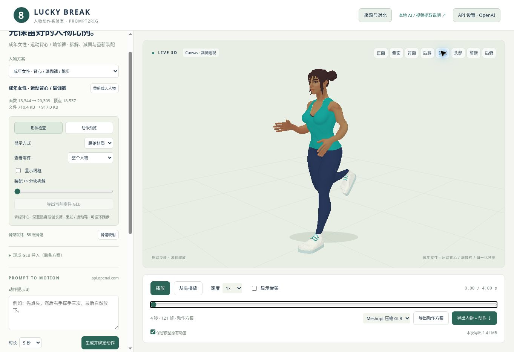
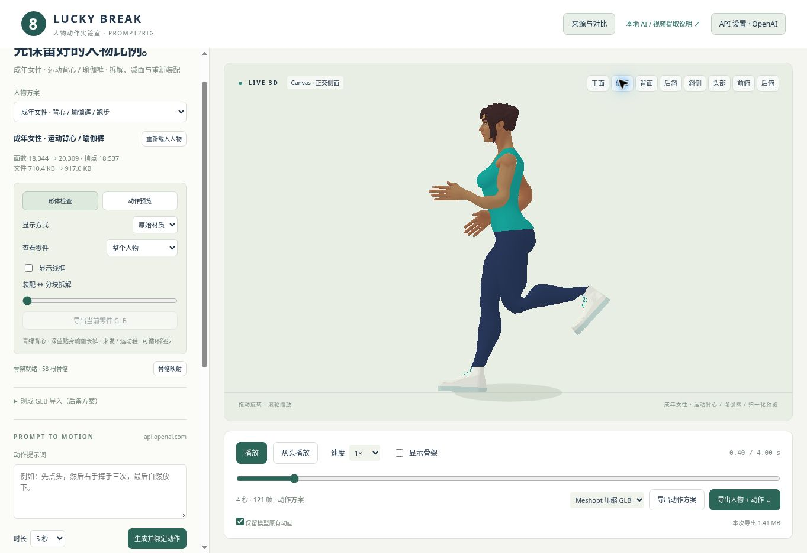
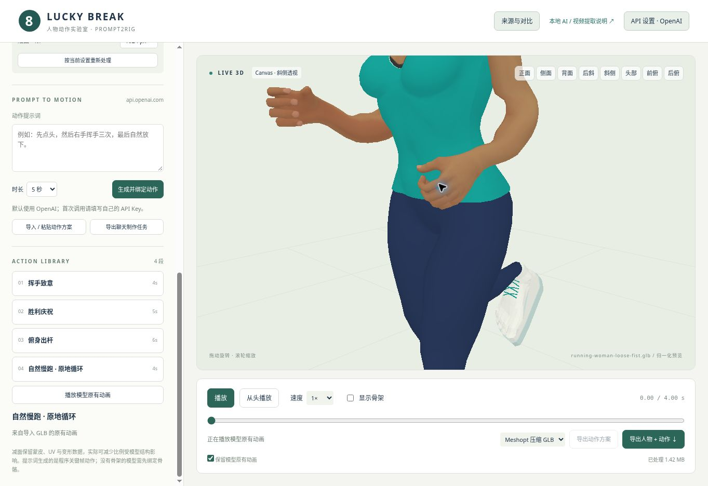
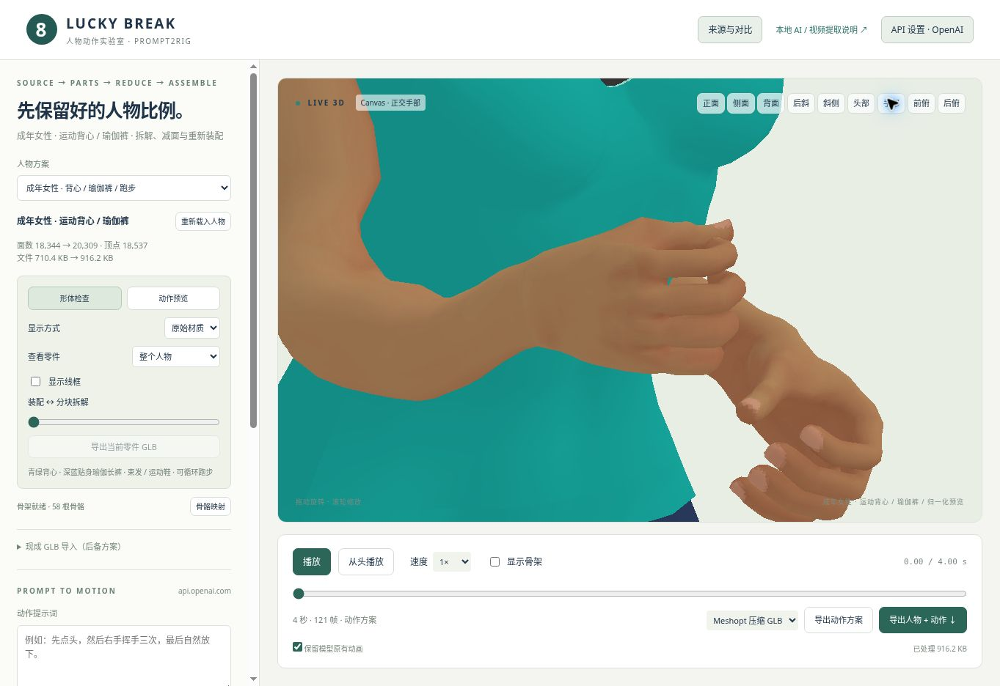
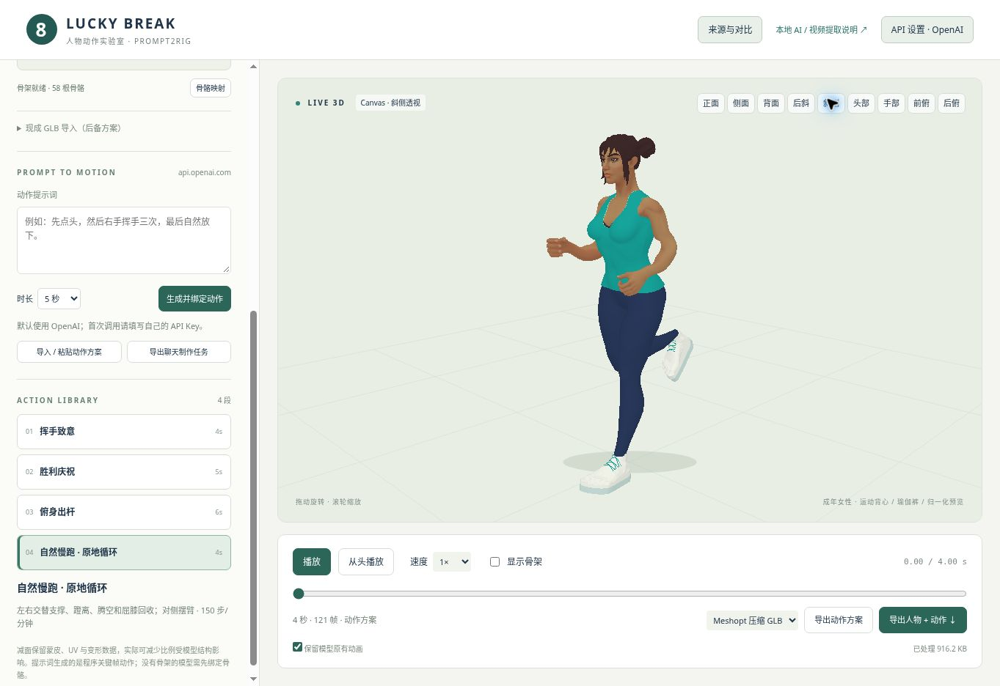

# 成年女性：运动背心、瑜伽裤与循环跑步

制作日期：2026-10-30（北京时间）。

**握拳更新已公开发布并完成网页复查。** 跑步双手自然松握拳，切换挥手后恢复张掌；“手部”按钮提供随右手摆臂跟随的近景。44 项工程检查、公开文件比对和实际网页导出复核通过；详见 [握拳更新报告](RUNNING_HANDS_VALIDATION.json)。后续新角色按 [默认风格与手型要求](CHARACTER_DEFAULTS.md) 执行。

入口：[直接打开女性跑步方案](https://giogyan90.github.io/3D_AItool/lab/?model=runner)。该入口默认播放跑步；点“形体检查”可以切回源绑定姿势，查看原材质 / 灰模、正侧背、前后俯视、单件和分块装配。少年和西装青年保留。

## 造型与来源

先核对 CharaBuilder，确认成女基础仍待建立；改用 Quaternius 的独立成年 **Superhero Female FullBody**，而非 Teen。具体作者页、CC0 证据、固定提交和逐文件哈希见 [SOURCES.md](../public/lab/characters/running-woman/SOURCES.md)。头脸、成年身体、眉眼和双束发来自作者；背心、瑜伽裤和运动鞋按同一基础构建，不声称整个人物从零雕刻。

本轮自行选择：赤足 1.68m、稳定双束发、青绿运动背心、深蓝贴身瑜伽长裤和浅色运动鞋；保留作者运动型成年比例。上衣为正常衣长，不是短款运动内衣。以上为可调整的制作选择，不写成用户确认的细节。

完整未遮挡基础保存为 `complete-source.glb`，可与装配体比较；身体原颜色图带内衣。该对比已统一坐标、骨名、单位和绑定姿势，不等于原始 glTF/bin。成品的面数 / 顶点 / 字节数及逐件清单在 [构建报告](RUNNING_WOMAN_BUILD.json) 中，裁衣、鞋和动作结构增加的面数如实计入，不能把压缩体积下降当减面。

## 衣物和骨架

- 背心沿实际胸背表面拟合，几何裁切前后领口、肩带、袖窿和下摆；开口边缘松量渐减至 2mm，用独立包边回接同一身体表面，并保留约 12mm 的衣内皮肤重叠，避免灰模中出现领口漏缝。按新覆盖范围删除衣内皮肤，肩峰、肩臂、腋窝与领口皮肤仍存在。背心不沿用裸上臂权重，否则垂臂时袖窿被拉折。
- 瑜伽裤使用连续腰胯、裆部、臀腿拓扑，保留贴身轮廓；隐藏裤腰内收，背心不撑大。裆部正中连续混合髋部与左右大腿，避免在 X=0 突然换侧。
- 约 100° 的屈膝暴露了原膝窝权重折叠；每膝新增半角弯曲辅助骨，并拓宽连续过渡。跑步掌面向身体内侧，通过前臂弯曲后绕轴校正得到，不强行翻手腕。裸露肩膀和手肘也要采样，不能只验证服装：肩部重分胸 / 锁骨 / 上臂权重，肘部用两根辅助骨分摊弯曲与前臂轴向变化。
- 65 个作者源关节加 6 根辅助骨，共 **71 个实际骨骼节点**；52 根标准动作骨骼加 6 根辅助骨，共 **58 根动作骨骼**。辅助骨实时与导出共用。
- 鞋面贴合实际脚型，鞋底依实际脚投影形成凸包；鞋面围边包覆完整脚部投影并回接鞋底平面，避免只在一个最低点相接而侧面仍漏空。左右鞋底跟随对应 Foot。鞋带交叉路径沿鞋面实际高度采样，不能用一根悬空或埋入鞋面的直条代替。裤脚权重过渡至脚骨；预览地面也按实际鞋底高度贴合。

## 头部来源与手型补充

头部、脸、眉眼和双束发是 Quaternius 的现成 CC0 素材，构建器保留其原形，只做整体比例、坐标、骨名与装配适配，没有重新雕刻头部。衣物、运动鞋与跑步数据为本项目构建。

上一版虽保留左右共 30 根指骨，动作协议只下发身体关节与掌面方向；简化标准驱动也没有完整指链，因此手指保持源绑定姿势的张掌。“支持指骨”并不意味着每一段动作已经制作手型。现以可选 `hands` 元数据跨过简化驱动，在目标自己的静止指轴上施加整段手型；跑步用双手 `looseFist`。四指弯曲与拇指靠拢分别控制，手腕朝向不变。

源指间权重的过窄过渡在屈曲时会翻折，装配体已局部校准：保留各指归属和原始几何，平滑中节 / 末节权重，并让远离拇指轴的虎口泄漏权重渐退回掌骨。完整源对比及头脸几何保留。手型与身体同样实时应用、烘焙、导出并重载；切回无手型旧动作或形体检查后不残留拳头。当前支持整段固定 `open` / `relaxed` / `looseFist` / `fist`，尚未提供逐指关键帧或手型时间变化。网页“手部”近景跟随右手，拖动可旋转检查。

## 跑步与接地

动作走 `planToTake → applyRetarget / retargetTake → GLB`，没有付费 API 调用。4 秒内包含五个 0.8 秒步态周期（150 步/分钟），61 个关键姿态符合原有协议，不修改 1–20 秒 / 64 姿态限制。左右腿相差半周期，对侧摆臂，肘部保持弯曲，骨盆与躯干克制反转；踝部局部角度控制在约 45° 内。

标准驱动骨架按接触 / 承重 / 支撑 / 腾空的足部高度校准 root；目标再以**实际左右鞋底表面的最低点**修正整体高度，保留驱动的腾空量。这样不会把“脚骨没入地”误当成“鞋底已接地”，同时烘焙导出相同修正。此为垂直接触校正，不是完整足部 IK。原地跑的支撑脚相对虚拟地面后移；支撑速度范围如实记在报告中，不保证恒定跑速或完全无滑步。需要接入有位移的游戏角色时，应另行匹配 root 速度、步幅和支撑相位。

## 本轮验证

工程新增 4 项女性专用测试和 4 项手型测试，原有 36 项保留，共 44 项通过。女性检查每次重新读取真实资产与实际跑步，不复用少年 / 西装的通过数字：

- 242 个表面姿势（静止 + 4 秒的 60Hz 采样），覆盖背心 / 包边、瑜伽裤、鞋面 / 鞋底 / 鞋带及外露左右肩臂；检查法线、三角面积和边长变化。
- 腰部截面按真实背心和裤腰检查，断言零件存在、样本非零且数值有限；没有用旧少年衣名做空检查。
- 241 个烘焙旋转采样，检查前臂轴向范围、腕部局部角、膝踝相邻帧连续性和首尾接缝。
- 完整人物与动作导出重载，对多个时刻的所有顶点逐点比较；灰模、单件、线框和拆解状态不污染输出。涉及实际鞋底接地时，必须在动作烘焙前恢复装配；只在 GLB 写出前恢复会把拆解鞋底的位置误算进髋部高度。新增回归比较正常 / 拆解视图烘焙的全部轨道。原嵌入身体 / 眼睛贴图的字节也单独比较。

本轮数值结果：最小法线对齐约 0.27570、最小面积比约 0.24108、最大边伸长约 2.29397 倍（含实际屈指表面）；46,464 个腰部径向样本最小间距约 1.62mm，无采样穿入。腕部最大局部角约 4.65°，踝部约 45°；导出重载比较 185,370 个顶点，最大误差约 0.00000031m。

- 新手型检查覆盖 30 根实际指骨、镜像掌向、明显内收、重复调用不累加、左右手独立设置、旧动作清理、30 条指骨动画轨道及实时 / 烘焙一致。整段跑步的表面与导出顶点检查同步覆盖握拳后的真实手指。

详细数值与范围：[RUNNING_WOMAN_VALIDATION.json](RUNNING_WOMAN_VALIDATION.json)。浏览器实际复查已覆盖灰模正 / 侧 / 背 / 前后俯视、真实材质斜侧，以及跑步接触、另一侧支撑与连续播放。领口漏缝、掌面和鞋底围边均按发现的问题修正后复查。

初版张掌的 [浏览器与发布检查记录](RUNNING_WOMAN_BROWSER_VALIDATION.json) 保存公开文件哈希和真实网页导出检查。实际点击“导出人物 + 动作”时故意保持灰模、仅看头发、拆解=1、线框开启：下载的 GLB 仍为完整 17 件人物、58 根动作骨骼 / 59 条轨道、4 秒动画及 2 张嵌入贴图；重载比较 185,370 个顶点，最大误差约 0.00000048m，贴图解码像素完全一致。浏览器导出约 1.41MiB，与离线包的体积差来自 PNG 重编码等序列化差异，不代表几何或颜色改变。

实际复查使用 Canvas CPU 兼容预览，未验证 GPU WebGL 路径。高度校正仍不等于完整足部 IK，也没有宣称任意动作无穿模。





本次握拳更新以本地文件导入现有页面，关闭再次减面后播放文件原有动画；检查双手近景、0 / 0.4s 对侧支撑与连续播放。实际浏览器重导出保留 30 条指骨轨道，185,370 个顶点的最大误差约 0.000000003m，贴图像素一致。此路径作为本地文件复查保留；随后已在新公开网页上完成手部跟随、挥手 / 跑步切换与实际导出检查。



公开部署后的实际导出在中性灰模、仅看头发、拆解=1、线框开启状态下执行，重载仍为完整 17 件人物、58 根动作骨骼 / 59 条轨道，其中 30 条指骨轨道；185,370 个顶点的最大误差约 0.00000048m，两张贴图解码像素完全一致。14 个公开文件与本地发布内容逐字节一致。“手部”镜头在 0 / 0.4s 都跟随右手；切到挥手 1.2s 为张掌，再切回跑步恢复松握拳。复查仍使用 Canvas CPU 兼容路径，未验证 GPU WebGL。





## 重建与检查

从 `experiments/prompt2rig` 执行：

```sh
python tools/fetch-running-woman-source.py /path/to/runner-source
RUNNER_SOURCE=/path/to/runner-source node --experimental-loader ./tests/vendor-loader.mjs tools/build-running-woman.mjs
node --experimental-loader ./tests/vendor-loader.mjs tools/check-running-woman.mjs --write
npm test
```

PowerShell 先用 `$env:RUNNER_SOURCE="C:\path\to\runner-source"` 设置路径，再运行 Node 构建命令。构建器核对每个源文件哈希；检查不通过时不会保存有效交付的动作文件。

检查实际网页下载的 GLB（贴图像素复核需 Python Pillow）：

```sh
node --experimental-loader ./tests/vendor-loader.mjs tools/check-browser-run-export.mjs /path/to/browser-export.glb
```

本地文件导入后的原生动画重导出可加 `--imported` 检查，包含导入时的 1.8m 归一化变换；该模式不冒充已部署手型 API 的检查。

输出：

- `public/lab/characters/running-woman/assembled-running-woman.glb`：静止人物。
- `public/lab/characters/running-woman/running-woman-run.glb`：人物、完整骨架、跑步动画和嵌入贴图。
- `public/lab/characters/running-woman/running-plan.json`：可导入网页的动作方案。
- `public/lab/characters/running-woman/complete-source.glb`：完整基础对比。

网页内也可以导出人物 + 当前动作；Meshopt 版在游戏端要配置 MeshoptDecoder。运行时与输出文件的检查限制相同。

从仓库根运行 `node experiments/prompt2rig/tools/build-pages.mjs`，源码和根 `docs/` 网站一起提交，核对 Pages 部署及公开文件哈希。
